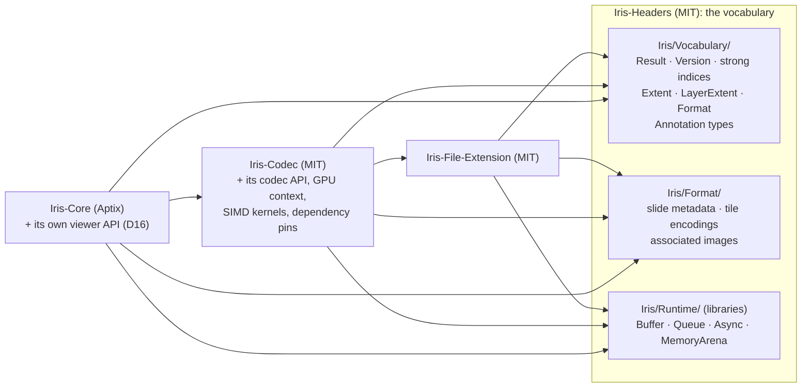
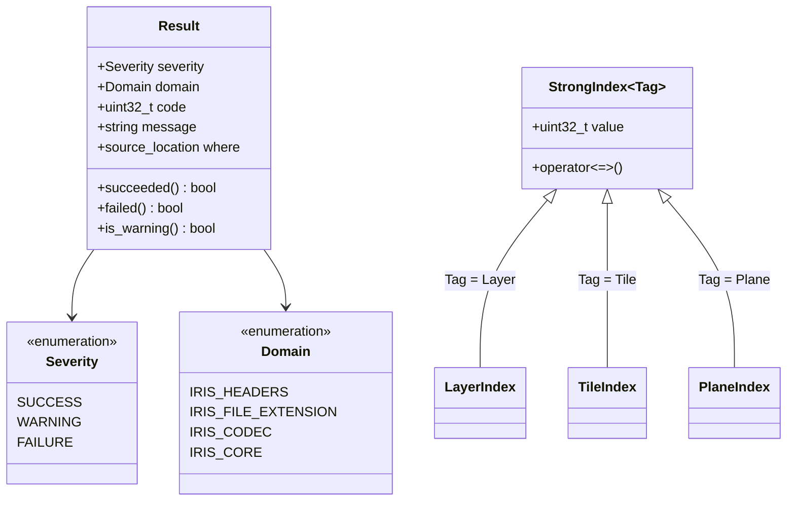
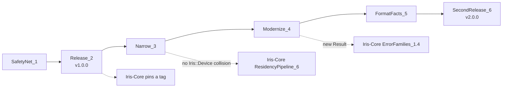

# Iris-Headers modernization plan

**Status:** decisions answered 2026-11-12 (§4); the plan is ready to build.
Nothing below is built yet; its diagrams await a render (mermaid-cli). **Owner:** Ryan.

Ryan, 2026-11-12: "Any changes that are needed to the upstream Iris-Headers are
allowed. We are migrating this project to as modern a design architecture as we
can." And on its purpose: "I wanted to ensure both open source and proprietary
projects share a common language."

## 1. Purpose

Iris-Headers is the shared vocabulary of the Iris family: the types that the
open-source tools (Iris-File-Extension, Iris-Codec; MIT) and Aptix's
proprietary engine (Iris-Core) all speak, so a `Result`, a `Buffer` or a tile
index means the same thing on both sides of a call. The dependency points one
way: proprietary code depends on this MIT repository, and nothing proprietary
flows into it (Iris-Core ARCHITECTURE D20).

That purpose is sound. What the repository holds today mixes it with three
other things, and its types predate the style rules the family now follows.
This plan narrows the repository to the vocabulary, modernizes those types,
and releases them by tag, without breaking a consumer at any step.

## 2. What is there today (read 2026-11-12, `ryanlandvater/Iris-Headers` at `0ba637d`)

| Finding | Evidence | Why it matters |
|---|---|---|
| **The old viewer API lives here.** `IrisCore.hpp` declares IrisV2's engine API: `create_viewer`, `viewer_open_slide`, `viewer_engine_translate`, `viewer_engine_zoom`, `viewer_annotate_slide`; `IrisTypes.hpp` holds their info structs and the `Viewer` and `Slide` handles | `include/IrisCore.hpp:37–117`, `include/IrisTypes.hpp:219–300, 353, 424–` | The engine's API belongs to the engine. Iris-Core replaced it with a lifecycle API plus bridge messages (Iris-Core D16), so this copy is stale, and it places a product API in an MIT repository |
| **Engine and binding internals live here.** `priv/IrisCoreVulkan.hpp` includes Vulkan, MoltenVK and VMA headers; `priv/IrisCorePython.hpp` holds Python glue | `priv/IrisCoreVulkan.hpp`, `priv/IrisCorePython.hpp` | A vocabulary that pulls in a graphics API cannot be included by a consumer that does not use it |
| **The codec's API lives here.** `IrisCodecCore.hpp` and the handle part of `IrisCodecTypes.hpp` (`Context`, `Slide`, `Cache`, `Encoder`) are Iris-Codec's public API | `include/IrisCodecCore.hpp`, `include/IrisCodecTypes.hpp:46–82` | A codec API change forces a vocabulary release |
| **A name collision with Iris-Core.** `IrisCodecTypes.hpp` declares `Iris::Instance`, `Iris::Device` and `Iris::Queue` as `shared_ptr` aliases of IrisV2's internals; Iris-Core's RIG defines `Iris::Device` as a class (Iris-Core D2) | `include/IrisCodecTypes.hpp:31–35` | Iris-Core cannot include the codec's headers for its CPU decode path (Iris-Core ResidencyPipeline_6) |
| **Other repositories' version pins live here.** `cmake/dependencies.cmake` pins the Vulkan SDK, VMA, GLM, pybind11, Highway, zlib-ng, libpng, libjpeg-turbo, libavif, libdicom and OpenSlide for every consumer | `cmake/dependencies.cmake` | Every one of those is Iris-Codec's dependency (Highway also serves `IrisSIMD.cpp`); bumping one releases the vocabulary |
| **Weak types.** `LayerIndex`, `TileIndex` and `ImageIndex` are all `uint32_t` aliases, so one passes where another is expected without a diagnostic | `include/IrisTypes.hpp:105–107` | Iris-Core requires strong index types (its ARCHITECTURE §6) |
| **`Result` is a flag and a string.** An unscoped `ResultFlag` bit field; conversion to `bool` is true for a warning; `operator==` against `bool`; the default constructor is not `noexcept`; parameters named `__f` and `__s` | `include/IrisTypes.hpp:113–164` | Iris-Core's errors carry a family, a code, the offending value and the place of failure (its ARCHITECTURE §6); identifiers with a double underscore are reserved to the implementation in C++ |
| **`IRIS_EXPORT` has two states where it needs three** (exporting, importing, static); unscoped `enum IRIS_EXPORT` declarations, where the attribute has no effect | `NOTES_FROM_IFE.md` §5; `include/IrisTypes.hpp:113` | `LNK2019` and `C2491` on Windows static builds, which IFE works around |
| **Inconsistent naming and guards.** `Create_strong_buffer`, `Wrap_weak_buffer_fom_data` (sic) beside snake_case; guards `IrisQueueV2_h`, `IrisBuffer_hpp` | `include/IrisCore.hpp:159–250`; `TODO.md` | The family style guide: `snake_case` functions |
| **No releases, two homes.** No tags; `IrisDigitalPathology/Iris-Headers` (the canonical repository, `5e91221`) and `ryanlandvater/Iris-Headers` (the development fork, 7 commits ahead) diverge; consumers fetch `main` | `git tag` empty; `cmake/dependencies.cmake` header ("track their owner's tips"); IFE `CMakeLists.txt:84–120` | A consumer cannot pin a release; Iris-Core pins the fork's commit today |
| **No CI.** Nothing compiles these headers, alone or against a consumer | `TODO.md` "Downstream drift CI" | Every change below needs a safety net first |
| **Open format facts from IFE 1.1.** `LayerExtent::zPlanes`, `Metadata::micronsPerPlane`, the clinical metadata range, and (Iris-Core D22) the `UASTC`, `XUASTC`, `AV1` encodings | `NOTES_FROM_IFE.md` §1–3; Iris-Core ExternalDependencies_0.4.1 | Parked as workarounds in IFE |

Who includes what, today:

| Header | IFE | Iris-Codec | Iris-Core (planned) |
|---|---|---|---|
| `IrisTypes.hpp` (`Result`, `Buffer` handle, extents, annotations, formats) | yes | yes | yes |
| `IrisCodecTypes.hpp` (slide metadata, encodings, images; codec handles) | yes | yes | from ResidencyPipeline_6 |
| `IrisCodecCore.hpp` (codec API) | — | yes | from ResidencyPipeline_6 |
| `IrisCore.hpp` (IrisV2 viewer API, Buffer functions) | — | yes (Buffer functions) | — |
| `priv/IrisBuffer.hpp`, `IrisQueue.hpp`, `IrisAsync.hpp` | — | yes | yes (Iris-Core D1) |
| `priv/IrisMemory.hpp` | yes | — | — |
| `priv/IrisSIMD.hpp` | — | yes | — |
| `priv/IrisCoreVulkan.hpp`, `IrisCorePython.hpp` | — | `IrisCoreVulkan.hpp` | — |

## 3. Target

What leaves, and where it goes:

| Leaves | Goes to | Because |
|---|---|---|
| `IrisCore.hpp` viewer API, viewer info structs, `Viewer` and `Slide` handles | Iris-Core `include/Iris/Core/` (rewritten to its D16 lifecycle), deleted here | the engine owns its API |
| `priv/IrisCoreVulkan.hpp`, `priv/IrisCorePython.hpp` | Iris-Codec (its GPU context) and Iris-Core (its bindings), whichever still needs them | engine and binding internals |
| Codec handles and API (`Context`, `Slide`, `Cache`, `Encoder`, `IrisCodecCore.hpp`) and the `Iris::Instance` / `Device` / `Queue` aliases | Iris-Codec, under `IrisCodec::` | removes the collision with Iris-Core's `Iris::Device` |
| `cmake/dependencies.cmake`, `priv/IrisSIMD.hpp`, `src/IrisSIMD.cpp` | Iris-Codec | they are the codec's dependencies and kernels |

What stays, modernized:

- **`Result`** (ResultShapeQuestion_3, answered): a scoped `Severity` replaces the bit field;
  `Domain` says which project's code it is, and `code` is that project's own
  error enumeration, so Iris-Core keeps its error families (its ARCHITECTURE
  §6) and the codec keeps its own without this repository knowing either;
  `message` carries the offending value; `where` is a `std::source_location`
  filled at the failure. `[[nodiscard]]` on every function returning it, no
  conversion to `bool` (callers write `succeeded()` or `failed()`), every
  member `noexcept`. `std::expected` would be the natural carrier for a value
  or an error, but it needs C++23 and the family builds C++20 (measured
  2026-11-12: Apple clang 21 defines `__cpp_lib_expected` only under
  `-std=c++23`); Iris-Core's completions already pass `(Result, T)` (its D13).
- **Strong indices**: one `StrongIndex<Tag>` template, so `LayerIndex`,
  `TileIndex`, `PlaneIndex` and `ImageIndex` cannot be mixed; the raw number
  only at the wire, through `value`.
- **Scoped enumerations** for `Format`, `AnnotationTypes`, `Encoding`,
  `MetadataType`, `ImageEncoding`, `ImageOrientation`, and the generated
  constants named from IFE's `spec/ife_constants.json`, so the file format
  stays the one source of each value (Arbiter's "named values" rule).
- **`IRIS_EXPORT` with three states** (export, import, static), as IFE's
  `IFE_Export.hpp` already does; no export attribute on an enumeration.
- **Libraries instead of loose sources**: `Buffer`, `Queue`, `Async` and
  `MemoryArena` become static library targets in CMake and Bazel
  (`iris_headers_runtime`), so a consumer links them instead of compiling
  `src/*.cpp` itself (the `README.md` already promises this).
- **Layout** under `include/Iris/` with `#pragma once`, one header per type
  family, `snake_case` functions, no reserved identifiers.

## 4. Decisions for Ryan

Each question has a proposal and Ryan's dated answer.

| Q | Question | Proposal |
|---|---|---|
| VocabularyScopeQuestion_1 | Narrow Iris-Headers to the shared vocabulary (§3), moving the viewer API to Iris-Core and the codec API, GPU context, SIMD kernels and dependency pins to Iris-Codec? | **Answered 2026-11-12 (Ryan): narrow it**, as proposed. Only the common language stays, so a change to one project's API never releases the others' vocabulary |
| CanonicalHomeQuestion_2 | Which repository is canonical, and how are releases made? | Proposed: the IrisDigitalPathology repository canonical, transfer to Aptix later. **Answered 2026-11-12 (Ryan): move to Aptix now**, before the first tag, and keep it **public under MIT** (follow-up, same day), so IFE, Iris-Codec and community users fetch it without credentials and nothing proprietary enters it (Iris-Core D20). `Aptix-Bio/Iris-Headers` becomes canonical; `ryanlandvater/Iris-Headers` stays the development fork that IFE's fork-mirroring fetches; releases are signed SemVer tags on `Aptix-Bio/Iris-Headers`, and Iris-Core pins a tag and its hash. A transfer redirects the old URL for links, `git clone`, `fetch` and `push`, until a repository is created at the old location, which deletes the redirect ([GitHub, transferring a repository](https://docs.github.com/en/repositories/creating-and-managing-repositories/transferring-a-repository), read 2026-11-12); so nothing is ever created at `IrisDigitalPathology/Iris-Headers` again, and consumers move to the new URL in their next pull request |
| ResultShapeQuestion_3 | `Result`'s new shape: `Severity` + `Domain` + project code + message + `source_location` (§3)? | **Answered 2026-11-12 (Ryan): as proposed**, with `succeeded()` / `failed()` and no conversion to `bool`, `[[nodiscard]]`, every member `noexcept` |
| BreakingReleaseQuestion_4 | One breaking release (2.0.0) with every consumer moved in step, or a release that deprecates first and removes in the next? | **Answered 2026-11-12 (Ryan): one breaking release**, as proposed; the downstream build (SafetyNet_1) proves each consumer before the tag, and no deprecation shim is written |
| StrongIndicesQuestion_5 | Strong indices for `LayerIndex`, `TileIndex`, `ImageIndex`, plus `PlaneIndex` (Z-stacks)? | **Answered 2026-11-12 (Ryan): strong indices**, one `StrongIndex<Tag>` template, as proposed; IFE's generator emits them |
| MemoryArenaQuestion_6 | Does `MemoryArena` (from FastFHIR) stay here? | **Answered 2026-11-12 (Ryan): it stays**, in the `iris_headers_runtime` library with Buffer, Queue and Async, since IFE and Iris-Codec both need it and IFE cannot depend on the codec |

## 5. Work breakdown

Names follow the family's convention (phase → work package → task → steps;
spelled-out names; evidence on every tick). Each phase leaves every consumer
building.

### SafetyNet_1 — nothing changes without a consumer proving it

- [ ] **StandaloneHeaderBuild_1.1** — every public header compiles alone and all together in one translation unit, on Linux, macOS and Windows, with Clang (Iris-Core D38)
- [ ] **DownstreamBuild_1.2** — the workflow sketched in `TODO.md`: IFE and Iris-Codec built and tested against this checkout through `FETCHCONTENT_SOURCE_DIR_IRISHEADERS`, with the control run against `main` so a consumer already red does not block; Iris-Core added as a third consumer once its `feature/Scaffold_1` merges
- [ ] **TypeTests_1.3** — Catch2 tests for today's `Result`, `Buffer`, `IrisQueue`, `Async` and `MemoryArena` behaviour, so the rewrite in Modernize_3 is checked against what consumers rely on

### Release_2 — a version consumers can pin

- [ ] **ForksReconciled_2.1** — the fork's 7 commits (`2f6e777` … `0ba637d`) merged into `IrisDigitalPathology/Iris-Headers` by pull request, so the transfer carries one history
- [ ] **TransferredToAptix_2.3** — Ryan transfers `IrisDigitalPathology/Iris-Headers` to `Aptix-Bio`, public, MIT unchanged (CanonicalHomeQuestion_2); the old URL redirects; IFE's fork-mirroring and Iris-Codec's `cmake/iris-repositories.cmake` name `Aptix-Bio` as the canonical owner; nothing is created at the old location
- [ ] **FirstTag_2.2** — `v1.0.0`, signed, on `Aptix-Bio/Iris-Headers` after TransferredToAptix_2.3, matching `MODULE.bazel`'s version; Iris-Core's pin moved from `0ba637d` to it (Iris-Core IrisHeadersRelease_0.4.9)

### Narrow_3 — only the vocabulary stays (VocabularyScopeQuestion_1)

- [ ] **ViewerApiRemoved_3.1** — `IrisCore.hpp`'s viewer functions, info structs and `Viewer` / `Slide` handles deleted; Iris-Core defines its own lifecycle API (its PublicApiComplete_11.1); the Buffer functions move to the runtime library (Modernize_4)
- [ ] **CodecApiMoved_3.2** — codec handles, `IrisCodecCore.hpp`, the `Iris::Instance` / `Device` / `Queue` aliases, `priv/IrisCoreVulkan.hpp` moved to Iris-Codec under `IrisCodec::`; a consumer test includes Iris-Core's RIG header and the codec's headers in one translation unit
- [ ] **PinsAndSimdMoved_3.3** — `cmake/dependencies.cmake`, `IrisSIMD` and its tests moved to Iris-Codec; IFE's and the codec's builds updated in the same step
- [ ] **PythonGlueMoved_3.4** — `priv/IrisCorePython.hpp` moved to whichever binding uses it, or deleted if none does

### Modernize_4 — the types the family's style guide asks for (ResultShapeQuestion_3, StrongIndicesQuestion_5)

- [ ] **ResultRedesigned_4.1** — `Severity`, `Domain`, code, message, `source_location`; tests red first; every consumer moved (BreakingReleaseQuestion_4)
- [ ] **StrongIndices_4.2** — `StrongIndex<Tag>`; IFE's generator emits it
- [ ] **ScopedEnumerations_4.3** — every enumeration scoped; values named from IFE's constants
- [ ] **ExportMacro_4.4** — three-state `IRIS_EXPORT` (`NOTES_FROM_IFE.md` §5); IFE's `IRIS_EXPORT=` workaround deleted
- [ ] **RuntimeLibraries_4.5** — `iris_headers_runtime` static library (Buffer, Queue, Async, MemoryArena) in CMake and Bazel; `snake_case` Buffer functions; `README.md` true
- [ ] **LayoutAndGuards_4.6** — `include/Iris/…`, `#pragma once`, no reserved identifiers, clang-tidy with Iris-Core's `.clang-tidy` checks clean
- [ ] **WindowsPaths_4.7** — `CreateFileW` with wide paths in `MemoryArena` (`TODO.md`)

### FormatFacts_5 — IFE 1.1's parked fields land here

- [ ] **ZPlanes_5.1** — `LayerExtent::zPlanes` (`uint16_t`, never zero in memory), IFE's parallel `planes` vector deleted (`NOTES_FROM_IFE.md` §1)
- [ ] **MicronsPerPlane_5.2** — `Metadata::micronsPerPlane` (§2)
- [ ] **ClinicalRange_5.3** — clinical metadata as offset, size and encoding (§3)
- [ ] **TileEncodings_5.4** — `UASTC`, `XUASTC`, `AV1` encodings and the in-focus plane, with IFE's M3 (Iris-Core D8, D9, D22)

### SecondRelease_6

- [ ] **BreakingRelease_6.1** — `v2.0.0` tagged once SafetyNet_1's downstream build is green for IFE, Iris-Codec and Iris-Core against it; each consumer's pin moved in its own pull request

## 6. Order and what waits on it

Iris-Core's ErrorFamilies_1.4 builds its error families on `Result`. It can
start against today's `Result` and move with ResultRedesigned_4.1, or wait for
it. With ResultShapeQuestion_3 answered, ErrorFamilies_1.4 is built on the
new shape directly, once ResultRedesigned_4.1 lands, since the shape decides
its conversion code.
